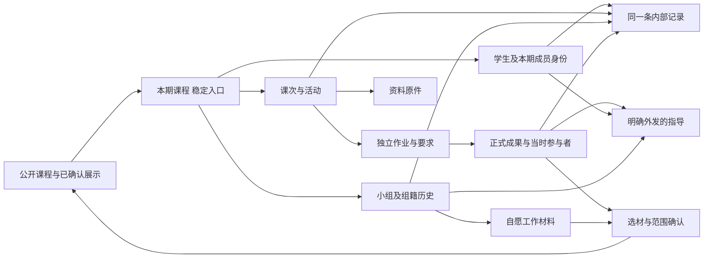

# 课程网站整体设计与分批实施

更新日期：2026-11-09。

学生、教师和助教围绕同一期课程共同工作。网站以稳定课程入口连接课次、人、小组与成果，让当前行动有依据、现场信息能保存、接手的人能继续工作。全学期需求构成设计范围，每批实现一条可核对的完整任务。本文件记录取舍、实施顺序和验收依据；完成情况以文末批次记录为准。

## 用户截图复审后的设计取舍 · 2026-11-09

本节的页面重构已实现，业务走查见[本轮验收记录](experience-review.md#自由首页本课记录与原处返回--2026-11-09)。用户直接指出：主页应由助教决定，固定的上节回顾／下节准备过于死板；三个并列编辑入口难理解；课堂记录在课、学生、小组之间反复切换；学生页的组籍空栏目和“收到的指导”不符合实际工作。此前五项功能的隔离测试通过，只能证明路径可执行，不能证明这些页面好用。本节替代下文旧方案中对应的固定首页栏位、独立课堂记录工作台与专门发指导流程；历史实施记录保留为事实。

### 页面先确定正在处理什么

- **课程首页。** 一个自由正文、一个“编辑首页”入口。助教可以写通知、回顾、准备、放图片和引用原课次／作业，自己决定顺序和篇幅，不必填两段规定格式。原回顾与准备在重构时保留为可编辑正文，不静默丢弃；原未发布草稿也要保留。作业目录始终可达，学生提交状态来自实际提交，引用作业时随原件显示。新建课次进入课次目录。
- **课次。** 目录直接列各课，标题进入教学内容；教学团队另有本课的“课堂记录”入口。同一个课次标题下切换“课程内容／课堂记录”，学生只见已发布内容。课堂记录默认写本课的情况，正文即可保存，关联学生或小组选填。保存、阅读与更正留在本课。既然已经进入本课，就不再出现“选择课次”、全期双重筛选或先选人／组选项。正文提到名字不自动替助教建立关联。
- **学生。** 标题为姓名和可点的当前组；确有调组经历才补一行旧组及已知日期。下面直接读存在的课堂备注、作品和评语，按日期及真实来源连续排列，空类别不展示。只有一份作品就先读这份作品；完全没有材料只写“暂无记录”。可以按需从页首“记一笔”，不在每份作品下和页尾重复放表单。
- **小组。** 标题下列可点的当前成员，已有自由工作正文直接读，随后回看课堂备注和共同作品。明确属于该组情境的个人备注带姓名，旧组作品和旧备注留在旧组，不随当前组籍搬动。
- **作业。** 先读要求与材料，教学团队主动进入“提交情况”后才看统计、范围与名单。由统计进入同一正式提交并写评语，再回原范围。普通评语留在作品；移除专门“给学生／小组反馈”和“收到的指导”产品入口。若已有实际发出的内容，按原读者和来源保留读取，不删除或扩大可见范围。

### 入口、视觉与返回

共用主要导航为“课程首页／课次／作业”，教学团队另可直接找“学生／小组”，学生有“我的小组”。资料、教学团队及课程管理保留次级入口。全期课堂记录不再与课次并列成另一套工作台。

页标题明确当前对象，正文占主要位置，一个本页主要操作紧邻标题或相应内容。组名、成员、课次和作品标题本身就是链接；不为每个关系造一格。表单在动作发生时展开，作者与日期轻量附在正文之后，不把记录类型、历史和更正字段变成首屏阅读负担。公开内容的发布操作与内部课堂记录的保存位置分开，读者只在相关位置说明一次。

返回保留来路及查找条件：课次记录→学生→原课次；学生→旧组／原作品→该学生→原姓名筛选；统计→正式提交→原统计范围。跨周作业各处引用同一原件，不复制成每周任务。未关联课次的历史备注保留未知，也允许直接在学生／小组页记课外普通备注。

### 实施边界与下一轮判据

实现复用现有正文编辑、草稿发布、课次和作业引用、正式版本、组籍与参与快照、记录 ID 及权限。新增数据库约束允许同期开课的课次直接承载整课备注，不填学生或小组时必须有课次，原有个人与小组记录不改写。首页公开与私稿分别展开旧短提示，仅正常保存时回写普通块。旧外发内容继续按原读者读取，旧未发草稿只供原作者复制或清除。

“首页自由编辑→课次→本课记录→学生／小组→返回原课”与“作业要求→统计→具体作品→原范围”已完成隔离业务走查，包括整课记录不选对象、未分组零记录学生、调组前原作业、姓名筛选返回、学生拒绝读取内部记录以及归档后回读。此次只迁移隔离测试和虚构本地预览，未迁移真实教学环境。下一轮请真实助教不听解释完成同样任务，重点观察自由首页如何组织课次入口、长学期记录的默认展开量与手机现场记事；模拟操作通过不替代这项验证。

## 证据与适用范围

| 证据 | 本轮可核对的内容 | 能支持什么及限制 |
| --- | --- | --- |
| 用户原话 | 本聊天 11 月 9 日完整任务；此前明确指出稳定首页、隔周三问、学生自行组队，以及教师助教随手记录发言和请假 | 是产品约束与使用者需求；不证明具体操作频率、课堂耗时或所有师生的理解 |
| 原始文件 | 用户本轮提供的六份文件，原件索引及定位见下表 | 已只读核对原件；支持课程计划、材料关系及工作表的结构判断，不能据此认定计划已执行、材料属于同组同次交付或本站已易用 |
| 需求来源索引 | [思维课需求基线](thinking-course-requirements.md#来源与证据限制)及历次设计说明 | 用于找线索；结论与下表原件逐项核对，未核对的转述保持待核对 |
| 历史实现与走查 | [设计记录](../DESIGN.md)、[体验走查](experience-review.md)及相应源码 | 用于了解已有能力、已测反例和迁移基础。隔离样本、角色模拟与截图不能作为真实课堂行为证据 |
| 本轮入口观察 | 后台 Safari 指定隔离标签：公开首页→我的课程→教师课程首页→第一课 | 课次正文只有教学内容与作业，找人需绕到小组目录；源码进一步确认课次来源仅作返回参数，未保存到观察记录。学生和助教理解仍待真人观察 |
| 尚缺的现场证据 | 教师当场速记、请假原消息及处理、助教交接、下一课和期末的实际回查 | 决定记录是否够快、默认分类是否自然、同事能否解释旧记录；不影响先完成已明确需求的可逆实现 |

### 本轮原件索引

文件由用户在本聊天提供。以下以内容哈希前 16 位辅助辨认版本，含个人身份的材料使用匿名名称；原件不改写，个人评分、学号及评语不复制到仓库或演示课堂。DOCX 以原表行、章节和题号定位；临时渲染缺少中文字形，不把渲染页码当成原件页码。

| 编号、原件、SHA-256 前缀 | 可复核位置及事实 | 能推导什么；不能推导什么 |
| --- | --- | --- |
| E1《2026秋季学期课程计划-思维》，`ed90555a962c63a7` | 总表第 3 周布置 Paper Robots，第 4、5 周放假，第 6 周不上课但交视频；第 9 周多教室分组点评；第 12、13 周原型测试，第 14 周初步方案，第 15 周展会 | 任务与项目跨课次持续，不能只存进某周首页。计划没有给出该视频的精确截止时间或实际回执；未确认的企业参访也不能被网站显示为已定行程 |
| E1，同上 | 9 月 12 日、第 2 周一行包含按座位分组和登记成员的安排 | 原计划采用课堂组织分组。课前自助组队来自用户后续明确要求，不冒充原计划的结论；新方案须保留正式名单与变动记录，教师处理例外 |
| E2 教学工作表，`3ced1ad152d30ad6` | `工作表1!A1:L1` 为组序号、成员/组长、学号、课题、小组分、阶段汇报、结课出勤、成果、个人总评建议和评论备注等列；`A2:L61` 中组级列合并而成员、出勤、建议和备注按人保存 | 同一教学回顾同时需要组级成果和个人材料，不能把组分/组成果当成个人参与的证明。表头没有独立的逐事件发生/登记时间，空白不能解释为缺勤。本轮不把现有评分表自动变成网站评分制度 |
| E3 个人介绍 PDF（匿名），`a1a1058ba0bf9c7f` | 第 1 页背景、兴趣与学习期待，第 2 页活动经历，第 3 页合作分工自述 | 个人介绍可用于初识时了解背景，按需作为普通材料读取；它不能支持以自评为中心的持续能力档案，也不是本期组籍或贡献凭据 |
| E4《Benchmarking竞品对标调研报告》，`2474860551797c96` | 第一至三节区分样本采集、功能/卖点分析和评价维度；第二节引用 Needfinding 结果解释竞品空白 | 一份成果会依赖多项来源；竞品的用户反馈是研究材料，不是任课教师对学生的指导 |
| E5《居家机器人需求调研问卷》，`599924e7e76c8fd5` | Q7、Q19 的选项/小计/比例表；Q24 提示另行下载填空题明细 | 当前文件是汇总结果，不能虚构已有逐个受访者原始答案或可复算的全量明细 |
| E6《居家机器人需求调研报告_厨房场景专项》，`7a54e1cc94c6d8dd` | §1.2 统计口径、图 3-1 与 Q7、表 3-1 与 Q19、§6.3 待验证问题；表 3-1 首项全样本值可与 E5 同名条目对照 | 正式版本应容纳多件材料及明确关联，指导应能指到当时报告、图表和来源题目。材料联系不证明同组、同次交付或展示许可 |

后续补证优先还原同一次事件的通知、操作、记录与后续使用。作品原件说明材料形态；课程计划说明计划；实际通知、回执和现场行为才说明执行。当前思维课材料不自动规定实践课的项目节奏。

证据分类在每轮保留：用户确认的约束（U）、原件事实（E）、亲自操作观察（O）、当事人回忆（R）、设计假设（H）。本轮 O 是 AI 操作隔离网站；没有新增真人访谈、现场课堂观察或真实用户行为统计。E2 中写下的评价是原作者的记录，不能升级为本轮独立观察到的事实。

## 全学期的工作与交接

| 时段 | 学生要完成的工作 | 教师要完成的工作 | 助教要完成的工作 | 交接成立的依据 |
| --- | --- | --- | --- | --- |
| 认识与进入课程 | 理解学习方式，找到正确课程和学期 | 说明本期开课目标、安排和参与方式 | 知道本期教学分工与资料位置 | 公开介绍和成员课堂有明确边界，登录保留原目标 |
| 开学与合作形成 | 先做个人准备，确认正式组籍 | 明确合作规则，处理确需帮助的情况 | 掌握实际成员、需要接续的事项 | 学生与教学团队看到同一正式关系，未入组仍能读资料和做个人任务 |
| 每次课前 | 确认已交、上节内容和下节准备 | 调整安排，查上次观察及已知情况 | 按分工独立整理/发布课次、关联资料与已有作业，掌握负责对象与相关成果 | 学生从原课次读到助教发布的内容；课次、截止和组籍分别有可靠来源，未发布不等于无需准备 |
| 课堂现场 | 交流、调研、制作和合作 | 组织活动、观察与指导，按需留下一条记录 | 找到人或组、材料与待跟进事项，记录现场情况 | 记录归对对象与情境，不要求先有作业或正式提交 |
| 课后与跨课 | 确认交付，理解指导并继续工作 | 补记、更正、给予指导和交接 | 找回同一事件、补充观察、按分工发送署名指导，辨认未解决问题 | 学生可读回针对原件的署名指导；内部观察与外发指导区分，跨周任务继续可达 |
| 期末与归档 | 回顾个人与共同成果，选择展示材料 | 按证据回顾学生，确认展示范围 | 整理与接续教学记录 | 当时参与与当前组籍区分；内部记录不自动公开；旧成果仍可读 |

网站负责可靠保存、查找、明确状态和接续关系。现场交流、寻找合作伙伴的社交过程与教学判断继续由当事人完成。网站引用已有外部材料时，不承诺其内容已经被封存。身份和选课名单沿用[既有对接范围](ustc-integration.md)，本轮不扩大到教务审批。

助教的教学动作不以课程管理权限为前提。当前已有课次编辑/发布、引用有权读取的资料和发送指导的权限；正式资料创建/发布与例外调组仍要求相应管理权限，是与共享教学工作需求的已知差距。第二批分别按“管理正式资料”“处理组籍例外”决定单项授权范围和审计，不能通过授予助教整体管理权解决。开课、归档、角色授予仍是管理动作。校方 SSO 与正式名单尚未接入；隔离账号验证的是选定身份后的站内路径，不代表真实开课前置条件已经完成。

## 助教工作支持与本轮五项交付

用户指出，上一版把个人自述看得过重，又把日常教学笔记设计成观察、判断、指导和修订互相关联的档案。该批评针对工作模型本身，不能只把新增流程改成“可选”后继续保留。个人介绍回到普通课程材料的位置；取消围绕自评追踪能力变化、要求逐条关联判断依据及修改传导的设计。原件 E3 只能证明存在个人介绍，不能决定助教日常工作的重心。

本轮以用户随后明确提出的五项操作为交付范围：方便看一名学生在历次课堂、作业与小组中的表现；方便看一项作业的统计；方便看小组在历次课堂与作业中的表现；方便更新课程主页；方便开始新一周的课与记录。这里先以当前这期的历次课次组织阅读，往期课程保留既有归档入口。以下为本轮实现目标，完成情况另记。

助教平时在课前准备、听汇报、看作品、讨论问题、回应学生和协助教师之间工作。对学生的认识来自日常接触；网站提供已有课堂备注、作品、评语和组籍供回想，不要求每个印象另写论证或定期更新人物档案。学生、小组和课次都是可直接进入的视角。看完材料可以离开，现场讲清楚即可继续上课，需要记的内容才记。

### 五项操作及实际支持

| 操作 | 应直接看见与完成什么 | 当前要补的地方 |
| --- | --- | --- |
| 看一个学生 | 他的所在组与过去组籍、历次课堂备注、个人与当时随组的作业、已有评语和指导；能直接打开相关课次或作品 | 提供独立学生入口和姓名查找，零记录、未分组及归档仍可找；原详情先读后写，关联已有内容，不重复录入个人介绍 |
| 看一项作业统计 | 应交、已交、未交或逾期未交、待评与已评；点数字看到相应学生或小组及实际提交 | 在原作业页给清楚的总览与名单；助教可切负责范围和全班，未分组个人提交能被发现。不凭备注数量或提交次数推断表现，不新增评分制度 |
| 看一个小组 | 成员与变动、历次课的组备注、共同工作、各次作业及评语；由成员进入个人 | 将既有材料组织成顺手的回顾，保持旧组经历。小组作品不自动等同每位组员的个人表现，不要求维护进度百分比、周报或项目阶段 |
| 更新课程主页 | 助教自由安排正文、图片和已有内容引用，从一个编辑入口修改、保存草稿或发布 | 取消固定回顾／准备两栏与重复快捷编辑；保留既有内容和未发布草稿，学生作业状态仍有固定可达入口 |
| 开始新一周 | 从课次目录新建本次课，写标题和安排，按需使用已有资料、作业；在同一课中记录情况 | 整课记录默认直接写正文，学生／小组关联选填。沿用稳定课程首页，不为每周再建一个首页，不自动复制或发布旧作业 |

作业统计先使用已有提交和评阅事实。当前兼容的评分字段没有构成正式评分流程，不把它们展示成已经采用的成绩制度。个人与小组回顾呈现已有文字和材料，助教可以据此写通常的评语；自述不作为评价轴，也不新增能力标签。

### 日常记录应是什么样

在小组讨论后，助教可以留“原型还没做出来，下次带个能试用的版本”；听学生发言后，可以留“这次汇报比较主动，能回应同学的问题”。系统带入当前人或组、课次、作者和登记时间，其余文字自由写。记录不要求拆成所见、解释和下一步三份，也不要求分别关联证据。普通笔记在产品上应能方便补充、改错和移除；既有后台历史机制服务于数据恢复，不成为助教需要理解和维护的修改链。

下次课回来，助教打开同一组就能回想上次谈到哪里，点某个学生能回看他的课堂备注和相关作业。期末需要写评语时，再翻这些材料。不要求每次观察都形成判断、每次指导都跟踪回应，暂不增加独立收藏待办、指派确认或教学问题状态。

正式作业仍对应实际提交版本，组籍保留当时关系，教学团队内部笔记不直接展示给学生。这些规则由系统执行，不让日常阅读充满技术说明或反复确认。新的证据关联、修改传播、全格式批注和复杂外发纠错工作流从本轮优先级移除。

### 连续操作与验收

沿五条真实入口分别检查：课程首页找学生，读其课堂与作业再返回；作业目录进统计，点人数到相应名单和作品；小组目录进本组回顾，再从成员进入个人；助教在首页更新提示，由学生读回；助教创建新课并开始记录，另一位教学成员能在该课及对应人或组找回。

本轮在隔离课堂以虚构材料操作 Safari。检查零记录、未分组、调组、归档、无提交和草稿等具体情况；不能将空白记录解释成表现差。以减少查找、绕路和重复录入为目的，真实师生的耗时与理解仍需实际使用验证。无需把所有日常动作都变成需要保存的事项。

## 从证据到需求

| 需求与触发 | 需要判断或完成什么 | 支持依据 | 设计回应与验收 |
| --- | --- | --- | --- |
| 学生隔周返课 | 是否还需提交；上节做了什么；下节准备什么 | U：用户明确要求；E1：布置与提交跨多周，中间有无课周 | 同一本期首页提供当前答案和原件链接。用组员代交、未发布准备、无课周任务检验，不能把空白解读为完成 |
| 首课前尚未入组 | 如何合作，何时算正式加入 | U：免去教师常规逐人操作；E1：原计划写明课堂按座位分组，实际执行未知 | 同一课程给出组队状态与行动，保留个人工作。自愿找人、招募、加入确认与正式组籍区分，教学团队按授权处理无人入组等例外；邀请机制仍需真实学生行为检验 |
| 教师助教课中想记一句话 | 找对学生，留住事实与情境 | 用户直接提出；首批改前入口走查 | 稳定的课堂记录入口和课次直达；选学生、写正文即可保存，其余按需补充 |
| 同事接手与下次回看 | 找到同一事件，知道是谁记录、涉及谁和哪次课 | 用户明确的连续工作要求；首批改前源码显示课次关联缺失，首批已补 | 课次、学生和明确关联的小组读取同一记录；以另一位助教按课次回读、再按人跨课回读验收 |
| 已交后继续项目 | 指导针对什么，接下来如何推进 | E1：跨课原型迭代；E4–E6：报告之间有来源关系；U：过程自愿 | 保留正式版本与多件原材料。章节、图表或题目定位是 H，需真实教师点评与后续改稿补证；不能把工作材料变成反复重交要求 |
| 期末回顾与对外展示 | 回顾有依据，选择公开内容 | E2：组级与个人回顾并存；E3：个人学习起点；E1：展会计划；U：区分展示范围 | 原参与快照与原观察可查；展示需选材并明确班内或互联网范围。展会计划不等于网络公开授权，展示工作流列入后续批次 |

每项设计须能由“原始事实或明确约束→当事人的问题→设计选择→可失败的判据”追溯。频率、耗时和降低负担的程度目前没有真人数据，不给出虚构百分比。

### 最小补证及可能改变的决定

| 尚不确定 | 最小补证 | 可能改变什么 |
| --- | --- | --- |
| 教师在现场怎样认出学生、多久能记完 | 在一节真实课观察几次自然发生的记事意图，保留座位/姓名/组的定位步骤，与现有纸笔或表格同任务比较 | 姓名查找是否足够；是否应优先组视图或授权名单辨认字段，而不是一开始建座位图 |
| 请假消息由谁确认、谁需要知道 | 一条已获授权且脱敏的原消息、实际处理结果及后续回查 | 仅记录来源是否足够，是否真的需要审批；目前不建审批或自动考勤 |
| 助教怎样接续、何时算处理完 | 一个实际交接前后事件，分别问交出与接手者做了什么 | 是否需要独立的跟进事项、责任人和状态；目前记录内容不自动成为待办，也不能将“已更正”误作“教学问题已解决” |
| 作品怎样交、指导指向哪里 | 一次真实交付包、回执、对应指导和后续改稿 | 附件/版本、章节定位和连续指导的优先级；E4–E6 不能代替真实交付关系 |
| 各角色是否理解入口和状态 | 未参与设计者完成下文固定任务，记录第一选择、提示和解释依据 | 栏目名称、首页顺序、空状态和回执表达；不以模拟走查证明理解 |

## 共同信息模型

连接表示可关联与查找，不表示自动产生记录、扩大读者或归因于某个人。

| 层次 | 对象或事实 | 生命周期与实现责任 |
| --- | --- | --- |
| 稳定对象 | 课程、本期开课、课次/活动、成员、小组、作业、资料原件 | 稳定 ID 与可定位原页；首页和课次引用同一来源；课程与开课分开，以支持历史学期 |
| 事件 | 加入/离组、正式提交、发布指导、记下一条观察、追加更正/撤回 | 保存操作者、登记时间及适用对象；已有成果保留当时参与者；发生日期允许未知 |
| 当前状态 | 当前组籍、当前作业要求、最新正式版、已收到指导、记录有效/撤回 | 从对应事实与明确动作取得；不从缺失日志推断行为，不从页面创建时间推断上课时间 |
| 需要另行确认的工作 | 跟进事项、展示选材和读者范围 | 属于后续独立动作；原观察不是自动待办，作品上传不是公开许可。按真实交接和选材规则确定状态机 |

首批记录状态为“未保存草稿 → 已保存有效记录 → 追加更正，或附原因撤回”。失败时仍是本地草稿；结果未确认时保留原请求号重试。发生更正后当前视图显示有效版本，历史保留原文；撤回后只在明确选择的历史范围出现，不能当作教学事项完成状态。

课堂记录有一个主要对象，可关联课次、组情境和具体成果。记录对象、记录者、当时情境、发生日期、登记时间、读者分别表达。收到请假消息、已确认的请假结果、现场发言和教学判断保留不同语义；“已确认”只记录已有决定，须写明依据，不在这里批准请假或生成出勤结论。没有记录只表示暂无记录。

课次页面的创建或发布日期不充当上课日期。课后补记保留真实登记时间，发生日期可以未知。当前表单使用北京时间日历日期，以当地午夜编码为 ISO；旧 ISO 时分保留，但界面只承诺日期精度。新增或主动改动不能晚于北京时间今天；收到关于未来课次的请假消息，其“收到消息”的发生日期仍是已发生的日期。小组情境必须明确选择，并与该日期的组籍有交集；同日调组不猜具体时刻。旧记录原文、主键与日期值保留，未知课次或类型保持未知。

内部记录仅向本期有效教师和助教开放。发给学生的指导继续通过独立动作保存与发送。个人指导不会随小组材料扩散，组级材料也不证明某人的具体贡献。系统管理员身份本身不赋予本期教学观察的阅读权。

更正以追加版本保留原文、操作者和时间。原作者仍有本期教学身份时可更正或撤回自己的误记；同事可以另记补充。本期有效教师还可附原因撤回他人记录，不能改写他人正文；否则助教停用后，其错对象记录会无人能处理。原作者和实际撤回者分别保留，助教不能撤回同事记录。对象、课次或类型记错时撤回后重新记录，不把原观察静默移动给另一个人。这个有限纠错例外来自业务反例推导，尚需实际交接确认，不声称来自原件已有制度。

## 整站结构与取舍

| 候选 | 收益 | 代价与不适用处 | 决定 |
| --- | --- | --- | --- |
| 所有功能平铺在目录 | 每种能力都有直接入口 | 当前首页、作业和汇总页容易重复；使用者先理解模块才可行动 | 不作为主组织方式，目录保留为稳定查找位置 |
| 所有内容按周收进页面 | 教学阅读有连续情境 | 跨周作业、持续项目和个人观察会分散；无课周任务难定位 | 课次用来组织教学情境，不独占任务与记录 |
| 稳定课程入口连接课次、人、组和成果 | 各角色围绕相同事实工作，长期与当前信息能够相连 | 需要清晰的原页、回链和权限；关联不能变成重复副本 | 采用，按真实任务逐批检验 |

公开门户继续解释课程与展示已获准内容；课程选择负责进入正确学期。本期课程是日常稳定位置，学生首屏保留作业状态、回顾和准备；教师助教有组织课次、找人记录和接手工作的独立入口。

首次进入时，学生先核对课程学期和参与方式，未入组显示加入的规则与动作；教师先看到学生目前能读到的内容与待组织的课堂；助教先知道本期分工和可用的教学动作。日常返回时，学生从作业回执、上节内容、下节准备继续，教师与助教从本次课、学生/组和明确待跟进工作继续。历史学期保留单独的只读课程入口，课次历史可读，但不保存多个相互竞争的“本周首页”。

“未发布准备”与教师明确写下“无需额外准备”不同；“等待组员确认入组”与“正式在组”不同；“本地草稿”与“服务器正式回执”不同；“没有教学记录”与“未参与”不同。每个状态应说明可靠依据或缺失的信息，不用空白、颜色或泛化的“完成”替代事实。

新增的“课堂记录”属于教学团队工作入口。从课次直达时带入该课次，可按姓名找到包括未分组在内的学生；从课程首页进入可按课次或学生查找。记录的原页和个人回顾互相连接。学生导航不出现教学内部记录。现有资料、作业、小组和指导的独立原页保留，首页和课次引用它们，避免多份维护。

保留稳定首页、跨周作业、正式回执、组籍历史、内部与外发边界。合并的是重复的信息来源和记录逻辑；“我的学习”等泛化汇总的独立入口应由任务树测试决定保留、改名或并回首页/个人回顾，不因已有模块而长期并列。替换教师常规逐人分组为经确认的自助组籍路径；删除新方案中的重复周首页及从日志自动推断参与的逻辑。首批新增入口用来接上此前缺失的教学工作。暂缓自动考勤、评分、贡献推断、自动教学建议和请假审批，现有证据没有要求这些能力。

该组织会增加教师明确发布准备/回顾、作者按需写明来源的工作。更简单的方案是课次只留正文、教师继续写表格；当记录只需教师本人期末一次使用时，这种做法可能足够。当前选择网站内共享记录，是为了用户明确要求的当场保存和教师/助教接续；若真人比较发现增加的维护时间大于找回与交接收益，应减少结构字段或保留外部表格引用，不能强迫转移全部线下工作。

如果课堂观察显示教师主要凭座位或组定位，姓名查找不足，应调整定位方式；如果一课次页对应多次现场，应增加实际活动实例，不能偷用页面创建时间；如果团队无法理解记录分类，应先简化分类和来源表达。这些都是可推翻当前选择的证据。

## 开发顺序与迁移

| 批次 | 完整任务 | 依赖与取舍 | 完成判据 |
| --- | --- | --- | --- |
| 1 教学记录接续 | 课程或课次找人→记录→同事按课次接手→按人跨课回看→作者更正 | 复用已封存观察与独立反馈；补可空语义和情境、追加修订，保留旧入口与旧数据 | 同一记录在允许视图一致，草稿不跨课串用，权限/历史/重试/更正并发成立 |
| 2 助教五项日常操作 | 按学生回看；按作业看统计；按小组回看；更新首页；新建一周课次并记录 | 按用户最新五项要求在现有路径实施，复用已有材料、评语、组籍与发布能力；不增加个人评估档案或记录关联工作流 | 五条可见入口可走通；内容与统计正确；零记录、未分组、调组与归档不丢人或旧材料；助教发布后学生读回；操作简短且无重复填写 |
| 3 自愿过程与连续指导 | 学生保存一次活动及多件材料→组员接续→团队跟进→学生继续 | 自愿过程需要独立发生时间与材料；沿用正式交付和历史边界。先验证来源、说明与既有沟通；背景明确仍反复因责任未确认而漏做或重复，才试指派与接手确认，其他状态逐项补证 | 未记录不受负面推断；指导可回到准确成果版本/原件；另一位助教知道未解决什么，不把“已记下”误作“已处理”。是否需要章节级锚点仍待补证 |
| 4 回顾与展示 | 按人回看→小组选材→教学团队确认读者→读者查看 | 复用当时参与和正式材料；班内与互联网确认分别保存 | 内部观察不外发；后续修改不静默覆盖已确认展示；归档仍可读 |

每批保留入口、当前操作、实际结果和接手人的验收。首批优先是因为教师助教现场工作被现有作业结构遗漏，且缺失课次关系会持续损失历史情境；它同时补全三种回查视角。学生提交/回执已有实施基础，首批做回归，第二批深入减少首页维护和理解负担。连续项目与期末展示依赖版本、历史组籍和读者边界，随后实施。课堂频率与耗时缺少原始数据，优先级未伪造分数，后续可以被实测负担推翻。

开发复用现有 Next/React、Prisma/PostgreSQL 单体，复用身份、课程成员、课次、封存成果、参与快照和数据库不可变约束。新增能力留在现有业务服务及事务边界中；没有班级规模或维护团队证据支持拆微服务、搜索集群或事件平台。每批评估大班记录量、慢网络及运维恢复后，再决定索引、分页或后台任务；本轮没有代表性负载性能结论。

首批只追加字段、表与索引，不重写原观察、正式成果或参与快照。旧请求继续兼容，成员页/组页原入口继续可用。迁移前后核对原主键、正文、日期与读者；新字段可空。正式迁移先在备份副本核对数量、原字段和值域，再停旧写入、备份、部署迁移与兼容应用，复走权限与有效记录视图后恢复写入。失败时保留备份、日志及新追加记录，优先前向修复。

**恢复边界：**只增加结构而尚无新增语义写入时可评估旧版兼容回退；一旦产生更正或撤回，忽略修订的旧版会重新显示错误原文，不能直接回退。必须使用仍读取有效版本的兼容应用或修复当前版本。若恢复备份，先隔离并核对备份后的写入，不能把合法新记录丢弃为恢复代价。真实环境按已有授权执行，本轮只迁移隔离数据库，不导入六份原件中的真实教学数据。

## 验收协议

用户任务先定义起点、正确结果、何为提示、失败条件和反例。以下课堂人物和文字均为隔离样本，不是师生反馈。

**整站贯通验收**以同一期、同一学生和同一教学团队串起四段：首课前理解规则并确认组籍 → 隔周从稳定首页解释提交状态、上节内容和下节准备 → 读回正式回执及对应版本的署名指导 → 归档后找回原材料并辨认可展示范围。每段都从正常入口开始，并由接手角色读回同一事实。收到邀请但未确认时不能说已入组；组员保存工作稿不能说已提交；第一版的指导不能冒充第二版评阅；班内材料不能因归档而公开。这是跨批次协议，目前没有宣称整条路径已完成真人验收。

下表是**首批课堂记录及关联回归**的具体协议。

| 场景 | 通过条件 | 反例 |
| --- | --- | --- |
| 无作业、未分组学生在课堂发言 | 教师和助教均可从课次找到该生；正文与可见情境一致；保存后有回执和可查原记录 | 不应要求先交作业或加入小组；暂无记录不标记缺勤或未发言 |
| 收到请假与记录已有确认 | 两种含义、作者及依据可辨，均不生成审批或考勤 | “已确认”缺少来源时拒绝；收到消息不能自动升级为获准 |
| 同事按课次接手、随后按人回看 | 同一个记录 ID、正文、作者和课次可从两条路径找到 | 他期开课成员、学生及无本期教学身份的管理员不能读内部记录或计数 |
| 记录关联原组后调组 | 团队从原组情境找到原记录，按人仍可回看 | 新组不因当前组籍继承为自身情境；不能将未知历史填成当前组 |
| 更正、撤回、重复提交及并发 | 原文仍在；有效内容与修订者可辨；重试同请求只保存一次；旧修订冲突保留输入；原作者停用后本期教师可附原因撤回 | 教师代改他人正文、助教代撤同事记录、改正文重用请求键、换账号、归档写入均被拒绝 |
| 发生日期及补记 | 新建/主动改日期不得晚于北京时间今天；补记可不填发生日期；旧原值保持 | 未来课堂可以被关联，但不能把未来消息或发言写为已经发生；历史未知不自动取保存日 |
| 草稿与课次切换 | 同一标签按账号/对象/课次恢复对应草稿，失败保留文字 | A 课草稿不能默默带到 B 课，内部草稿不能成为外发反馈 |
| 学生回归 | 首页三问、个人材料、组员代交回执及已收到指导仍可达 | 学生完整响应与直链不含课堂内部记录 |

技术层使用隔离数据库、真实服务端响应、后台 Safari 和必要的自动化检查。窄屏布局、键盘和读屏分别注明实际覆盖；不以 DOM 调用替代原生键盘或手机触控结论。

真人层待原始材料和参与者可用后，选择未参与设计的教师、助教、学生。比较同等任务下现有纸笔/表格/群聊和候选网站：记录意图产生到回到课堂的时间、找人切页、放弃、接手者检索与复述正确性、学生无提示成功及误判完成、全团队重复录入与等待。需要保留多少记录由教学目的决定，不把全课堂每件事都记下作为漏记分母。预先固定条件、提示与判据，报告人数和失败，不将小样本推成总体结论。

每项真人任务从日常入口开始，不给栏目名称、点击位置或正确答案；任何指出位置、代操作或解释状态的介入均记为提示。完成要求使用者找到依据并解释当前状态，再由记录/回执核对。错误归人、内部信息外泄、误以为已交、把请假消息认作已批准属于阻止推广的失败；每一次都追查，不能用平均成功率抵消。第一轮先形成基线分布，再预登记时间目标，不事后挑选有利阈值。方案比较使用等难度不同案例，交替顺序，保留逐人时间、提示、放弃与失败；未观察到失败不等于证明失败率为零。

### 方法选择

| 方法与工具 | 要解决的问题、所需输入 | 产出影响的决定及当前状态 |
| --- | --- | --- |
| 原件逐项核对、事件追踪 | 计划/表格/作品到底记录了什么；需要原文件、实际通知和回执 | 本轮已用只读 OOXML、工作簿范围和 PDF 版面核对 E1–E6；影响跨周任务、个人/组边界及材料来源，不用二手需求替代 |
| 情境观察与具体事件访谈 | 实际课堂如何找人、记事和交接；需要师生自己的设备、材料与已发生事件 | 待真人开展；决定定位方式、最低字段、接续状态与总负担 |
| 任务/服务蓝图 | 同一任务由谁产生、记录、确认、使用；输入各角色原动作和业务约束 | 本文全学期工作表与交接列是初稿，尚未经全角色共创；决定站内外分工和责任，不能假设教师总是接手所有异常 |
| 领域模型、事件与状态表 | 对象、事件、当前状态是否混在一起；输入 U/E、代码与反例 | 本轮已用于区分课次/日期、收到/确认、原文/修订，发现作者停用与旧版回退反例。没有真人参与的工作坊不称为已完成 EventStorming |
| 树测试、最小交互任务 | “我的学习”、课堂记录、指导等名称是否被理解；输入少量候选结构和固定任务 | 待真人验证；先比较归类/首选，再用端到端任务核对状态与接手，不能用点击命中代替工作完成 |
| 数据库测试、HTTP 权限检查、Safari 走查 | 可见入口是否到达真实保存结果；权限、冲突、重试、历史是否成立 | 本轮技术证据；能推翻功能错误，不能证明课堂顺手或学习成效 |
| 可访问性与性能工具 | 表单标注、放大/窄屏、键盘/读屏、代表负载与网络是否可用 | 自动扫描与真实辅助技术分开；未执行部分保留待验。无覆盖报告不宣称 WCAG 或 ASVS 全面符合 |

方法依据：[情境观察](https://www.gov.uk/service-manual/user-research/contextual-research-and-observation)用于识别实际工作；[EventStorming](https://www.eventstorming.com/)用于共同澄清事件和责任；[树测试](https://www.nngroup.com/articles/tree-testing/)用于栏目归属；[可用性基准](https://www.gov.uk/service-manual/measuring-success/usability-benchmarking-a-website-or-whole-service)用于同任务对照。技术检查参考 [W3C 可访问性评估](https://www.w3.org/WAI/test-evaluate/)和 [OWASP ASVS](https://asvs.owasp.org/)的适用部分。它们提供方法或判据，不替代本站实际使用证据。

## 第一批实施与验收结果

整站工作模型、六份原件索引、结构候选、共同模型与四批开发顺序已建立。第一批教学记录完成了下列技术验收；第二批的最新实施结果见下一节，第三、四批仍是规划。真人课堂验收尚未完成。改动位于现有仓库，未发布或对真实课堂执行迁移。

| 证据类型 | 实际执行与结果 | 支持范围 |
| --- | --- | --- |
| 后台 Safari，改前/改后同一入口 | 改前从课次经小组目录、小组、成员页才找到观察表单；改后课次一次页面跳转进入课堂记录，按姓名选中未分组学生，只写正文即可保存并由回执定位原记录 | 入口和写入可用；页面跳转从三次到一次是这条隔离路径的观察，不是教师耗时降低的测量 |
| 后台 Safari，教师→助教→学生视角 | 教师保存后，助教从自己的课程/课次入口读到相同 ID、正文、作者和课次，再点学生读取同一记录。该学生没有组籍或正式成果，助教无课程管理入口仍可记录 | 验证不依赖分组/作业，以及本期教学角色接续；没有真人对记录的复述证据 |
| 后台 Safari，记录含义与草稿 | 缺少来源时“已确认请假”不能保存，正文保留；改为“收到请假”可保存。A 课次的未保存草稿在 B 课次为空，回 A 再选同一学生恢复 | 验证表单要求与课次草稿隔离；是否需要请假审批仍无证据，不建设审批 |
| 后台 Safari，更正与撤回 | 作者更正后同一 ID 显示新正文，历史保留原文/原因/操作者。教师撤回助教记录只可填原因，不可编辑其正文；默认列表移除，包含撤回时可读原作者与实际撤回者 | 写入/读回与权限界面成立。发现“撤回后成功提示随行消失”，修复后撤回最后一条仍显示回执，点历史到同一记录 |
| 后台 Safari，学生回归 | B 从稳定首页读到个人待交、小组已交、实际提交人、回顾未发布和准备原文；点最近指导到助教署名正文，点已交成果到相同正式版本、当时 A/B 名单与提交要求 | 实际旧功能回归，不将其解释为学生无提示理解测试；本轮未重新实施首课组队全链 |
| HTTP 独立会话 | 教师/助教的记录、课次筛选、两个成员页均 200。学生 A/B 与纯管理员均实际 404，完整响应未检出内部样例文字或记录 ID；学生首页/指导页正常且无内部入口 | 服务端权限及内容边界，不只依靠隐藏按钮；探测会话已退出 |
| 数据库及逻辑测试 | `npm test`：297 通过、0 失败、0 跳过；覆盖未来日期、新旧日期保留、跨课/组关系、作者停用后教师撤回、同事更正拒绝、归档、重试和并发。测试库自动销毁 | 自动化支持各断言，不等于真人可用性。相关用例见 `tests/teaching-observations.test.ts`、`tests/teaching-observation-edge-audit.test.ts` 等 |
| 真实迁移演练（仅隔离数据） | 迁移前保存一条旧观察；应用迁移后逐字段核对该观察与三条旧反馈，ID、原文、对象、作者、时间和情境一致；旧 kind/pageId/contextGroupId 全为空。追加新观察及修订后再次核对仍一致 | 证明该隔离样本没有被改写；正式库需独立备份、核对与恢复演练 |
| 工程与排版 | 最终代码生产构建与 TypeScript 通过，`git diff --check` 通过。Safari 去除脚本的只读副本在 320、390、768 像素下检查记录列表/历史/筛选，无横向溢出，筛选字段有标签 | 不是手机实机、原生键盘、读屏或完整 WCAG 审核；未测代表性网络和长期记录量 |

子代理参与原件核对、代码实现、独立反例审查和 HTTP 检查，主代理整合并实际操作 Safari。没有子代理判断被计作师生反馈。所有教学写入均为隔离虚构样本，六份原件保持只读；专用后台标签与本轮临时网站服务已关闭。

## 第二批五项日常操作的实施结果

本轮已在现有项目实现用户提出的五项操作，实际路径和反例记入[体验走查](experience-review.md#助教五项日常操作--2026-年-11-月-9-日)。上一版围绕个人自述、判断依据和修订传播的设计已撤掉。

| 操作 | 已实现与实际核验 |
| --- | --- |
| 看学生 | 独立学生目录与姓名查找；按课次读已有备注，直接读原版评语、收到的指导及过去组籍。未分组、零记录、调组及归档路径已核对 |
| 看作业统计 | 已交、未交／逾期、待评阅、已评阅数字进入相应名单；助教可切负责范围、全班和未分组学生。实际完成评阅后数字与名单一致更新 |
| 看小组 | 历次课次备注、原成果评语、组指导与工作正文直接可读；从旧组返回原学生保留课次，过去材料不随调组移动 |
| 更新首页 | 同一首页快捷编辑两段提示，单独发布时保留正文及正文草稿。助教发布后学生读回相同文字，草稿不外发 |
| 开始新课与记录 | 从首页填写标题和选填正文，引用已有作业／资料；保存直接进入课次编辑，可发布或直达本课记录。选学生／小组后只写正文即可记下，教师可接着读 |

后台 Safari 覆盖助教、学生、教师的交接；独立 HTTP 会话核对发布前404、发布后200与内部记录边界。304 项隔离测试、生产构建与类型检查通过。七类页面的 Safari 只读布局副本在320、390、768像素下没有整页横向溢出。测试不是师生反馈，也未测量真人耗时或进行手机实机、原生键盘、读屏验证。

当前学生／小组回顾按本期历次课次组织，往期仍从各自归档课程进入。已知的小断点是从姓名搜索经原件往返后未保留目录筛选；同一学生和原课次仍可找回。长学期的默认展开量需真实助教试用，后续自愿活动与展示不在本轮完成范围。
