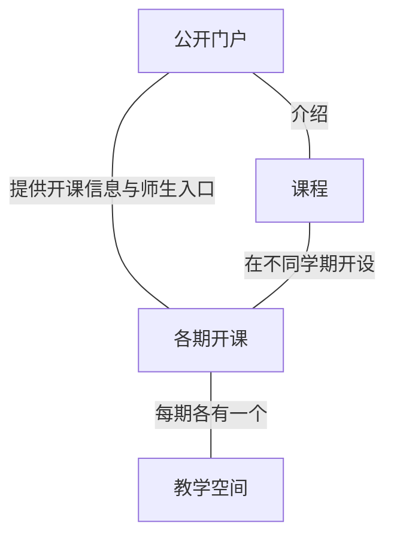
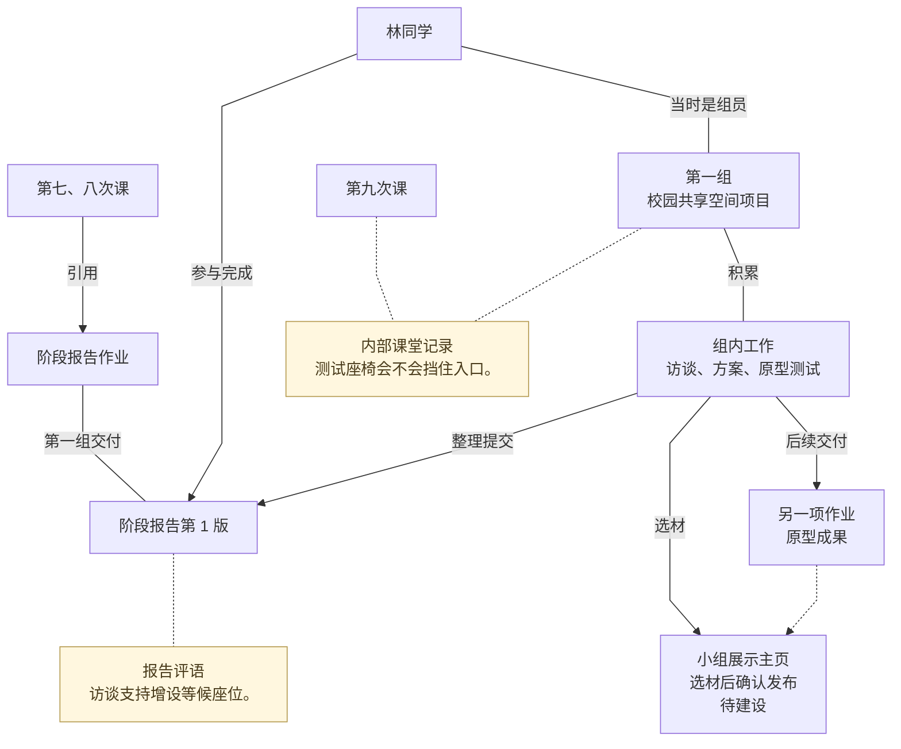
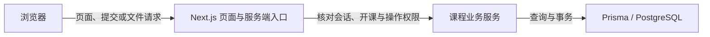

# 设计创新课程网站整体设计稿

设计基线为 2026 年 11 月 11 日。

下文用第一组的校园共享空间项目说明网站如何组织一期开课。示例中的学生、课次和项目经历均为虚构。

1. [产品定位与预期效果](#一-产品定位与预期效果)
2. [课堂教学与项目工作](#二-课堂教学与项目工作)
3. [总体架构](#三-总体架构)
4. [核心模块与关键交互](#四-核心模块与关键交互)
5. [业务规则与内容流转](#五-业务规则与内容流转)
6. [视觉与交互设计](#六-视觉与交互设计)
7. [技术架构与数据设计](#七-技术架构与数据设计)
8. [现有实现与后续计划](#八-现有实现与后续计划)

## 一 产品定位与预期效果

### 产品定位与服务范围

网站面向中国科学技术大学的设计创新思维、设计创新实践等课程。学生在这里开展学习与合作，教师和助教共同组织教学、持续指导学生，校内外读者可以了解课程、教学活动和设计成果。

设计创新学习通过观察、调研、讨论、构思、制作原型和测试逐步展开，既有个人练习，也有持续数周的小组项目。各门课程可以按教学目标、活动安排和项目周期组织内容，帮助学生利用资料和反馈推进方案，并说明自己的设计依据。

### 对学生学习与合作的支持

**理解学习安排，持续推进任务。**

学生进入课程后，能够看清学习目标、当前活动和下一步要准备的事，找到所需资料。课程更新后，仍能查到过去的安排和未完成的跨周任务。尚未分组时也能开展个人练习和课前准备。

**组织小组合作，积累共同工作。**

学生能够了解组队规则、寻找伙伴并确认组员。组员回到小组工作页时，能找到目前的方案、作出选择的依据和接下来要做的事。

**清楚交付成果，利用反馈改进。**

学生能够看清一次交付要呈现什么、由谁交和需要准备哪些材料。提交后，可核对教学团队收到的那一版成果及对应反馈。学生可以根据意见继续调研、修改方案或安排测试。

**回顾学习经历，表达设计成果。**

学生可以找回个人练习、参与过的小组成果和收到的反馈，回想设计思路与方案如何变化。整理汇报或展示时，可以选取材料说明关注的问题、采用的方法、作出的选择和形成的结果。

### 对教师与助教教学工作的支持

教师与助教共同承担课程准备、课堂组织、学生指导和成果评阅。教师侧重整体教学目标与节奏，助教参与具体教学组织并持续跟进学生和小组。网站应为团队提供共同的工作依据，同时支持各自分工。

**形成连贯的教学安排。**

教学团队能够把课程目标落实到课次活动、阅读材料、项目要求和交付安排中，向学生说明各项工作的目的及其联系。教师与助教可以共同准备内容，根据课堂进展补充说明、调整安排，让学生及时理解当前要求。

**了解课堂、学生与小组的实际情况。**

教学团队既能了解一项任务在全班的开展情况，也能持续跟进某个小组的项目，或回顾一位学生的学习经历。课堂交流、项目材料、正式成果与必要的文字记录能够相互参照，帮助团队辨认学生正在思考什么、遇到什么困难，以及哪些地方需要进一步沟通。

回顾时能够找到当时的作品和课堂情境，理解记录由谁留下、与什么事情有关。学生的个人材料、实际参与的共同成果和教学观察各有来路，为团队理解个体差异、合作情况与学习变化提供依据。

**开展有依据的指导与评价。**

教师和助教能够结合具体材料与教学情境给出意见，讨论学生如何理解问题、使用证据、作出选择并检验方案。连续跟进时，团队可以联系此前的工作和反馈，了解学生之后怎样回应，给出适合当前阶段的建议。

期末回顾使用日常积累的作品和记录，帮助教学团队形成对学生与小组学习情况的理解，并按需要补充总结。教学判断由教师和助教结合实际情况作出，网站提供可查阅、可联系上下文的材料支持。

**顺畅分工与接续工作。**

助教能找到备课、讨论和评阅所需的材料，持续跟进负责的学生和小组。临时接手一堂课、一组学生或一批作品时，能查到同事已做的工作、留下的意见和还要处理的事项。

**根据实际教学改进课程。**

教师能够结合课堂情况、学生成果与教学记录，回看哪些安排帮助学生推进了工作，哪些环节反复出现困难，以及哪些材料和案例值得继续使用。助教的现场经验也可以进入团队讨论，为调整内容难度、活动组织、项目节奏与指导方式提供依据。

### 对外介绍课程与展示成果

**介绍课程，帮助学生形成具体认识。**

考虑选课的学生能够了解课程主要学习什么、采用怎样的上课与合作方式、需要完成哪些工作，并找到相应的开课信息。课程介绍结合实际活动和往届作品，让学生对自己将参与的学习有具体预期。

**展示作品，让读者看懂学生做了什么。**

小组可通过展示主页介绍自己的项目。读者从研究的问题、关键发现、设计选择和最终成果理解作品如何形成，也能知道方案实际检验到了哪一步。

**记录课程活动与参与者的经历。**

通过新闻、故事等内容，介绍课程实际开展的课堂活动、参观、工作坊、展览和交流，以及师生在其中的经历。内容交代具体的人、事情和背景，让读者看到课程日常如何开展，也为这些活动留下可查阅的记录。

### 对课程长期建设与运营的支持

**保持持续、可信的课程表达。**

课程理念、教学活动、人物经历与项目成果能够得到持续整理和更新，形成有实际内容支撑的公开形象。读者容易辨认本期安排与往届内容，理解材料的时间和背景。

课程团队能够明确内容来源和维护责任，及时更新需要调整的信息。课程介绍与实际教学保持联系，公开内容随课程的发展不断充实。

**保存历届教学与项目经验。**

教学安排、资料、作品和课程故事按学期保存。师生可以回到相应开课查阅，课程团队也能依据保留的原有来源、参与关系和教学背景，选取案例或比较历届做法。

**支持新学期准备和团队交接。**

新加入的教师或助教可查阅常用材料、项目案例和前期留下的待办事项。准备新一期课程时，团队可以了解旧材料用在什么情境，再按新的目标、学生和时间安排调整。

**把课堂积累转化为交流材料。**

课程团队可按读者需要，将已有作品、过程材料和教学经历整理成展览、教学交流或合作沟通所需的材料。整理后的内容带有课程和学期背景，保留与原作品和参与者的联系，供后续教学与展示取用。

## 二 课堂教学与项目工作

### 按周教学与跨周项目

课堂按周组织，小组围绕同一个设计问题持续工作。学生在第七次课上练习访谈，第一组将方法用到校园共享空间的调研中。林同学拟定访谈提纲，组员一起讨论观察和访谈，发现午间等候需要更多座位。他们把这个发现放到小组工作页，并决定先做一版座椅摆放原型。个人练习可以为项目提供材料，小组也会做独立的课堂练习。

### 项目工作与正式交付

阶段报告作业要求各组从自己的项目工作中整理一份报告，交回已有的访谈发现和初步方案。第一组交回报告后继续修改方案、准备测试。他们用报告评语核对访谈证据支持哪些判断，再把需要验证的问题带到下一次课堂讨论。

到了原型讨论，教师和助教既会就方案向全组提建议，也会从发言中了解某个学生的思路。几组反复遇到的问题还会影响后面的教学安排。接手的同事需要知道意见是在哪次课、结合哪份材料、针对谁提出的，才能继续跟进。

## 三 总体架构

### 公开门户与课程教学空间

一门课程可以在不同学期开设。每期开课都有自己的教学空间，保存该期的成员、教学安排、项目工作和成果。公开门户介绍课程和各期的开课信息，并提供进入课堂的入口。

公开门户通过新闻和故事介绍课堂活动与项目经历。计划在公开开课页链接已向互联网发布的[小组展示主页](#小组展示主页)。用于交流的课堂材料注明来源课程和学期，也可供新一期教学选用。

### 一次开课中的教学关系

课次组织当堂活动，小组承载跨课次的项目工作，作业规定需要交回的成果。课程首页和不同课次可以引用同一项作业，要求与截止时间都从原作业读取。资料独立保存，可供多次课和作业引用。

**一个小组在连续教学期间推进一个项目。** 小组组织成员，也承载项目的连续工作。题目可以在探索中逐步明确，方案和材料在同一个小组内继续更新。组员变动时，原组继续推进已有项目。一次阶段作业可以面向全班，各组从自己的项目中整理成果交回。独立的小组练习留在相应作业下。

图中第一组从日常工作中整理阶段报告，继续用访谈发现制作和测试原型。第八次课的正文引用原作业，课上讨论报告第 1 版，评语就写在这一版。第九次课的内部记录同时关联课次和第一组。将来可以从该组的工作材料和已交成果选材，整理成同一小组的展示主页。

### 评价与回顾

助教从阶段报告作业查看第一组时，看的就是这组为本项作业交回的报告及评语。要了解这组怎样把访谈发现做成原型，可以从第一组出发，把组内方案、同一版报告、第九次课的测试建议和另一项作业交回的原型一起回顾。具体入口见[从交回报告到读到评语](#从交回报告到读到评语)和[小组工作页与教学回顾](#小组工作页与教学回顾)。

林同学参与完成了第 1 版。评价她的学习时，教师可直接采用报告原评语对这项共同工作的判断。要了解她个人怎样设计访谈问题，可以再看她的提纲或课堂发言。调组之后，原报告仍按提交时的成员名单回顾，见[调组前后的成果](#调组前后的成果)。

## 四 核心模块与关键交互

### 找到要上的课

访客从公开首页了解课程怎样开展，再从「课程与学期」查看本期开课。与公开开课关联的报道也可以直接打开该学期的介绍。学生在学校教务系统办理选课，已加入课程的师生可从开课页登录。直接打开课次、作业或资料链接时，登录后按当前账号的权限回到目标。

从默认入口登录且只有一门进行中的课程时，直接进入该课首页。要切换课程或回看往期，可从教学空间顶栏的「我的课程」打开列表，按课程名、学期和身份确认要进入哪一期。管理员通过「全部课程」查找开课。课程内始终能看到课名和学期，从「网站首页」可回到公开门户。

### 备课与发布

教师从「课次」目录点「新建课次」，先填标题保存草稿，再补上第七次课的安排。用「插入」引用阶段报告作业和访谈资料，写明学生这次要做什么。课次发布后，学生从目录或首页引用打开该课，读当次安排，再点进作业和材料。

教学团队从「编辑课程首页」更新回顾、当前任务或下次课准备。首页和课次都用连续 Markdown 写作，文字和引用可以一起移动或撤销。首页可插入课次、作业、资料，课次正文可插入作业和资料。用「保存草稿」留给团队接着写，用「学生预览」检查发布后学生能读到的范围。编辑器操作见[课程页面使用说明](course-page-editor.md)。

学生可从首页的「查看作业与提交情况」进入作业目录，或从「最近成果」直接打开提交版本。资料可以在正文中打开，也可以从「课程资料」按标题或正文查找。资料选择结果和正文引用旁都可打开预览。可识别的 PDF、PNG、JPEG、GIF、WebP 和纯文本在弹窗内阅读，其余文件可下载，外链打开原站。

### 从交回报告到读到评语

第一组从第七次课的引用打开阶段报告作业，先看要求、截止时间、配套材料和交付方式。尚未入组的同学也可先读要求，再去组队。一名组员代表小组交回报告，从回执打开成果，核对提交人、时间和材料。其他组员也能从原作业的「正式成果与反馈」查看同一版。需要补齐材料时，可在允许更正的期限内回原作业提交新版。

助教从作业详情或目录点「查看提交情况」，默认看到「负责范围」。第一组如果不在该范围内，可以切到「全班」。统计可查已交、未交或逾期未交、待评阅和已评阅，个人作业还可以查未分组学生。在第一组那一行点「查看作品」，打开它为本项作业交回的最新版本。要读被更正的旧版，可以从「更正历史」找回。

助教打开报告第 1 版，点「写评语」，填完后点「保存评语」。有权查看这一版的学生随即可以读到评语，助教可另行点「完成本轮评阅」。林同学从「本学期记录」点开第 1 版，在报告下读到原评语。往期报告从相应的归档课程打开。

### 课上记录，课后回看

第九次课讨论原型测试时，助教在该课切到「课堂记录」。点「记一笔」可直接写整堂课的观察。要留下关于第一组的测试建议，可以选第一组，把建议作为本课的内部记录保存。请假、未到或发言从「记学生情况」记，按姓名搜索、用组名辨认，可一次选多位学生记录同一种情况。保存后留在本课，可以定位刚写的记录。

本期有效教师和助教可从课次或相应学生、小组页回看这类记录。学生打开同一课次时，读的是已发布的课程内容。

### 小组工作页与教学回顾

学生从「我的小组」进入。组队开放时，可创建小组、通过邀请链接或班内招募确认加入。入组后，页面先呈现项目题目、组员、目前的方案和下一步要做的事。第一组可以写「已有第一版座椅摆放原型，下次在午间测量入口剩余通行宽度」，旁边直接打开原型和准备使用的测量表。项目刚开始时，也可以先写想研究的问题和下一步调查。

组员自由编辑项目正文，随手补充讨论结果和阶段决定。需要回看或交接的一次访谈或测试，可另存一条活动记录，带上材料，按需注明实际发生时间和参与者。涉及交付时，直接进入原作业或原版本。活动记录和工作页的新呈现顺序属于后续设计。

教师与助教从课程导航「小组」进入同一个组，在已有工作正文的基础上继续查「作业与评语」和内部「课堂记录」。第一组的阶段报告和原型各自打开具体成果；第九次课的测试建议可点课次标题回到原记录。课外情况可在组页用「记小组备注」写下，当堂发生的情况从相应课次记录。

### 小组展示主页

展示主页仍归同一个小组。组员从工作页进入「整理展示」，可以选取项目照片、过程材料和已交成果，在草稿中写出读者需要的来龙去脉。页面以项目题目、代表图和一句话说明开场，交代项目服务谁、遇到什么问题，并带出小组署名、课程和学期。正文用关键发现、设计选择和实物或测试结果说明方案怎样形成。各组可按自己的项目调整叙述顺序。

第一组可以用「为午间等候增设座位」作为展示标题，首图放一版座椅摆放原型。正文讲清为什么考虑加座、为什么需要留出通道，并在测试完成后补上实际发现。组员可先预览展示，教学团队确认并发布后，班内读者从课程内打开，访客从公开开课页打开互联网版本。发布规则见[小组选材与展示发布](#小组选材与展示发布)。

### 回顾个人经历

教师和助教可在「学生」按姓名找人，也可从课堂记录或小组点成员姓名。未分组或没有记录的学生也能找到。林同学的个人回顾可以找到个人提交，以及她列在「本次成员」中的小组成果。每份成果先列符合条件的最新版，较早的版本可展开。摘要引用较早版本时标为「旧版评语」，并提供原版入口。查看她以前所在的小组或某份成果后，可以回到她的页面，再回原课次或带有原筛选的学生名单。

学生从「本学期记录」回看自己的提交、当时参与的小组版本和收到的旧留言。教学团队要补充课外情况时，可以从学生页用「记个人备注」，备注归这名学生保存。

## 五 业务规则与内容流转

### 本期身份与组队

师生在每期开课中各有身份，同一个账号可以在一期做学生，在另一期做助教。长期课程负责人可以准备该课程的新一期，本期教师管理这一期的教学。全站管理员按管理权限进入课程。内部课堂记录、写评语、更新评阅状态和开放截止后更正，都要求具备本期有效教师或助教身份。

| 操作 | 学生 | 助教 | 教师 | 全站管理员（无本期教学身份） |
| --- | --- | --- | --- | --- |
| 首页及课次 | 读已发布正文 | 保存共享草稿、发布 | 保存共享草稿、发布 | 保存共享草稿、发布 |
| 作业及资料 | 读按状态开放的作业和资料 | 可读作业草稿，资料限已发布 | 创建、修改及发布 | 创建、修改及发布 |
| 组队和调组 | 在开放期间确认建组或加入 | 查看本期组籍 | 设置规则、处理调组 | 设置规则、处理调组 |
| 小组项目正文 | 读写当前所在组 | 查看本期各组 | 查看本期各组 | 按管理权限读写 |
| 正式成果 | 按个人或当前组提交，按权限回看 | 查看本期成果 | 查看本期成果 | 查看授权范围内的成果 |
| 指定成果的截止后更正 | 在有效期限内更正有权提交的成果 | 为已交成果设期限或撤销授权 | 为已交成果设期限或撤销授权 | — |
| 评语及评阅进度 | 读可见版本的评语和进度 | 写评语、完成或重开评阅 | 写评语、完成或重开评阅 | — |
| 内部课堂记录 | — | 读写本期记录，按规则更正或撤回本人记录 | 读写本期记录，按规则更正本人记录，可撤回本期记录 | — |

筹备中的课程向本期有效学生开放已发布内容，进入进行中后才按作业条件接受提交。课程归档后，组籍、作品和记录按原权限只读。

教师或管理员设定组队截止时间和人数上限。班内招募向本期未分组学生显示组名、说明和余位。学生确认建组或加入后形成正式组籍。重开组队形成新窗口，原邀请随原窗口到期或关闭。人工调组保留每次加入与离开的记录。未分组学生仍可读已发布资料，也可以按要求完成个人作业。

### 正文与原件何时生效

教师在「插入」中新建的作业或资料草稿单独保存，离开正文编辑后仍可从相应目录找回。保存正文草稿后，学生仍读上次发布的正文。「学生预览」按选定的发布范围显示编排，个人或小组的提交状态在学生用自己的账号打开时才显示。

发布课程首页或课次时，系统核对所引用原件的开课、状态和权限。教师或管理员可以勾选随正文一并发布的作业和资料草稿，包括作业的配套资料。作业和资料草稿以勾选结果为准，助教发布页面时只发布正文。首页引用的草稿课次在原课次发布。核对期间原件发生变化时，系统保留正文并要求重新确认。

去掉一处引用并发布页面，只移除该页的入口，学生还可以从目录打开已发布的作业和资料。撤回原资料会从学生和助教可读的正文中隐藏相应引用，旧的预览和下载地址也无法再向他们提供文件。撤回课次后，教学团队可从原课次继续整理并重新发布。

小组正文保存后，当前组员和有权限的读者可以立即阅读。载入历史正文再保存会形成新修订，已交回的成果仍按各自版本保存。

### 作业何时可以交

| 作业状态 | 学生看到什么 | 交付与评阅 |
| --- | --- | --- |
| 草稿 | — | 教师或管理员发布后开始提供给学生 |
| 已发布且未截止 | 要求、本人或本组进展 | 课程进行中且满足条件时可提交、更正 |
| 已截止 | 要求、已有成果及评语 | 到达截止时间后停止常规交付，指定的已交成果可获更正期限 |
| 已结束 | 要求、已有成果及评语 | 教师主动结束提交和更正，课程归档前仍可评阅 |
| 已取消 | 免交及原因、已有成果及评语 | 移出应交与催交，暂停提交和更正，课程归档前仍可评阅 |

已取消或已结束的作业可以由有权限的管理者重新发布，提交仍按课程状态与截止时间判断。更细的状态转换见[课程内容生命周期](course-content-lifecycle.md)。

### 提交、更正和评阅按版本保留

一段说明或一份附件即可提交，也可以把报告、记录表和原型图片放在一次交付里。提交时，系统核对作业要求、个人或当前小组归属、最新提交和有效期限。要求变化、组员已交新版或学生调组时，保留原有输入，等学生核对再交。小组作品页的「本次成员」取自交回该版时的有效学生组员名单。提交成功但未收到回执时，原样重试会返回原回执。

第一组发现阶段报告漏附访谈汇总表，可以在截止前更正。如果已经截止、作业仍发布且课程仍在进行，教师或助教可以只为第一组的这份已交成果开放更正期限，未交组仍按原截止处理。更正时可保留原附件、补上漏件或换入新文件，提交成功后形成新版本。作业取消时，已有更正授权暂停，教学团队仍可撤销。作业恢复发布时，尚在有效期的授权可继续使用。

评语和评阅进度都随具体成果版本保存。新版本进入待评阅，旧版保留原材料、评语和评阅记录。旧版已有评语但缺少评阅状态记录时，显示「历史评阅状态未确认」。个人作业按本期有效学生统计，小组作业按至少有一名有效学生的小组统计。每人或每组只有最新正式版本计入当前提交和评阅统计。

### 调组前后的成果

第一组交回第 1 版后，林同学调到第二组。第一组随后交回第 2 版，作业统计采用这组的第 2 版。林同学列在第 1 版的「本次成员」中，教学团队可以从她的个人回顾找回这一版及原评语，她自己也可以从「本学期记录」打开。

学生按当前组籍进入小组工作页，也可从原作业读取当前小组的共享成果。后来加入第一组的学生可以读到第 1 版及评语，个人回顾只收录「本次成员」名单里有该生的版本。项目工作和展示主页继续归原小组，展示的读者范围以发布时的确认为准。教学团队可按本期权限回看原组的工作。

### 课堂记录怎样归属和更正

整堂课的记录归课次。记到具体学生或小组时，还保存与所选对象的关系。请假表示收到请假消息，未到记录当时所见，发言保留实际内容。一次选多人时，只为确认名单中的学生保存记录。课堂记录和普通备注都保留作者和登记时间，旧记录缺少的实际发生日期按未知处理。

原作者可以更正正文。对象、课次或类型记错时，由原作者或本期教师说明原因撤回，再另记一条。更正和撤回留有原文、操作人和时间。

以前单独发出的留言仍可回看。个人留言供原收件人查阅，小组留言供当时的收件学生和该组当前成员查阅。

### 小组选材与展示发布

组员从工作材料和已交成果中选取可分享的内容，补写说明和必要的出处，再由教学团队核对内容与读者范围。班内分享供本期课程成员阅读，互联网发布供访客阅读，两种范围分别确认。课堂内部记录继续由本期教学团队查阅。

展示保留发布时确认的正文、图片及所选成果版本。读者在展示页阅读已获准的内容，原材料仍按各自权限读取。第一组后来换了原型图，展示主页继续呈现已发布的图片。小组想换成新图时，更新展示草稿，再确认发布。哪些教学成员承担确认与撤回由课程分工确定，见[后续计划](#接下来要完成的工作)。

## 六 视觉与交互设计

### 公开页面怎样安排阅读

公开首页先用课程介绍和学习场景说明学生在做什么，再展开交流、实践与合作、新闻、故事和开课信息。新闻先交代事件和时间，故事围绕人物或项目展开。小组展示主页以项目内容为主，读完可回到相应的公开开课页或继续浏览其他已发布的展示。

照片优先用实际讨论、访谈、模型和测试场景，说明文字交代背景。示意照片和故事样稿在相邻位置标明性质，合作关系和成果描述依据已核实的材料。公开页面用白底、近黑文字、较大照片和留白组织阅读，故事等栏目可用宋体标题。课堂空间延续白底和系统无衬线正文，用深蓝突出链接和主要操作。

### 课堂内容怎样排列

作业页先呈现当前要求，作品页突出成果所属的组或学生、提交人和版本。「提交时的作业要求」按需展开。旧版缺少这项记录时，显示「此历史提交未保存当时要求」。课堂记录和回顾页先呈现记录正文或评语摘要，提供课次或作品原件入口。没有内容时给出简短提示。用段落、空白和细线组织阅读，需要一起核对的材料或操作放在同一面板。

正文中的引用应能随教学说明一起读。引用在句中时保留标题和必要信息，例如作业的简短截止；单独成段时用简洁的信息行补充交付方式、当前状态或资料预览。标题直接打开原件。常用格式放在正文旁，复杂的旧内容可从「调整布局」维护。

### 操作完成后怎样继续

操作结果用文字说明。发布回执说明本期学生能读的新正文，并提示这次一并发布了多少项作业或资料。提交回执指向交回的版本，课堂记录回执指向本课刚写的记录。「尚未分组」「已截止」等状态应说明眼下能做什么。未记某位学生的课堂情况时，只表示该生没有相应的课堂记录。

要求、组籍或他人保存的内容变化时，指出具体差异，保留已填文字和选择。草稿只恢复了文件名时，提示重新选择文件。关闭预览回到原来的位置，在编辑器中保留原稿、选区和撤销历史。助教从「待评阅」打开第一组当时最新的第 1 版，完成评阅后返回原筛选，可切到「已评阅」核对这一版。

### 窄屏、键盘与阅读辅助

课程名与学期在桌面和窄屏均可辨认。桌面用共用侧栏，窄屏用可展开的「课程导航」，名单和统计按内容重排。手机上仍应顺着读完作业标题、截止和提交状态。课堂记录筛选新姓名时，应保留先前选中的学生。

键盘操作要有可见焦点、清楚的阅读和操作顺序，浮层关闭后回到触发位置。拖动提供可点按的移动操作，图标按钮有可读名称，图片有合适的替代文字。开启减少动态效果时，内容与操作反馈仍可辨认。

## 七 技术架构与数据设计

### 应用与读写边界

公开门户和教学空间运行在同一个 Next.js App Router 应用中。服务端按读者权限查询和渲染页面，浏览器中的 React 组件负责 Markdown 编辑、引用选择和资料预览等交互。「调整布局」按需加载 BlockNote，读取同一套文档结构保存的旧内容块。

`src/app/` 提供页面、写入和文件入口，`src/components/` 保存共用界面，`src/lib/` 执行课程规则，`prisma/` 保存结构和迁移。会话 Cookie 携带随机凭据，数据库保存凭据哈希和有效期。页面请求、写入和文件直达各自检查当前账号与相应权限。写入还核对请求来源，需要确认打开表单时身份的操作会再次比对账号。助教编辑带有受限资料的正文时，客户端只收到保留标记，保存时由服务端恢复原段落及引用。

### 数据怎样保存当时的教学情境

- **开课与成员。** `CourseOffering` 联系长期课程与学期。创建开课时为长期课程负责人建立本期教师关系。开课标识用于核对成员、内容和历史关联。组籍和助教分工保存有效起止。
- **正文与引用。** `CourseFocus` 保存首页，`CourseSubpage` 保存课次。发布版和共享草稿分开，修订号用于检查过期保存。读取引用时按权限取得原件的标题、截止或状态。首页发布时同步更新数据库中的作业、资料引用关系，课次链接保存在正文中。
- **要求与交付。** 每次保存作业会留下 `AssignmentRevision`。同一作业下，个人或小组有自己的 `Submission`，历次交付分别保存为 `SubmissionVersion`。小组交回时，系统将当时的有效学生组员写入 `SubmissionParticipant`，与说明、附件、实际提交人和当时的要求修订一起封存。旧版本没有要求快照时，保留未知。评语和评阅进度均以交付版本为关联对象。
- **课堂记录。** `TeachingObservation` 保存记录的作者、登记时间和关联。整课记录关联课次，写到个人或小组时可同时关联课次或提交版本。更正和撤回追加修订，读取时按修订结果呈现正文或撤回状态。
- **小组及项目工作。** 现有 `Group` 归属一次开课，并关联组籍、正式交付和课堂记录。`GroupPage` 保存该组的项目标题和内部工作正文，每次保存追加正文修订。后续活动记录和展示主页都以小组为归属；展示单独保存发布内容、读者范围和选材来源。

其他模型、字段与约束见[数据模型](data-model.md)和[数据库结构](../prisma/schema.prisma)。

### 一次操作怎样完成写入

发布正文与所选原件在同一事务内保存。组队确认同时检查组队窗口、当前组籍和人数。交付写齐材料、参与者和要求修订后封存。批量课堂记录为每个确认选中的学生保存一条，整批一起提交。支持重试的写入用请求标识核对账号、操作范围和内容，已成功的请求返回原结果。修订已变化时，拒绝旧表单覆盖并保留输入。

PostgreSQL 的同期开课复合外键、条件唯一索引和检查约束保护关键关系，触发器保护已封存版本及历史。账号、权限和当下教学条件仍由服务端核对。

### 文件与部署

资料与正式成果的文件字节存于 PostgreSQL，列表主要读取文件名和大小，通过文件入口检查权限后才交付字节。每条资料可附一个不超过 10 MiB 的文件，单版成果最多 20 件附件，保留及新增附件合计不超过 10 MiB。资料预览按扩展名和文件特征识别可用格式，纯文本最多返回五万字符。

部署沿用 Prisma 迁移链。上线前在适用的数据副本上确认旧组籍、提交版本和可读范围，再切换应用与数据库。备份与恢复需要用实际记录演练，例如恢复后，已撤回的课堂记录仍按撤回状态读取。

### 校方数据怎样接入

统一认证用于确认账号身份，课堂名单用于确定本期的教师、助教和学生，校历用于提供学期日期。课堂和学期按校方稳定标识匹配。确认退课或任课关系结束时，停用本期身份并保留历史记录。当前使用虚构演示账号、手工名单和教务处公开校历及已知快照。正式接口和同步约定见[科大接入方案](ustc-integration.md)。

## 八 现有实现与后续计划

### 当前能做什么，走查覆盖到哪里

截至 2026 年 11 月 11 日，网站是一套可在本地运行的教学原型，使用 PostgreSQL 和虚构演示数据。公开门户已有课程介绍、新闻、故事和开课入口，部分内容是样稿。成员空间支持按期教学、组队、小组正文、个人与小组提交、按版评阅、课堂记事和学期回顾。现有小组页可保存项目标题和共享正文，组内活动记录与小组展示主页列入后续建设。首页和课次各保留已发布正文和一份共享草稿。分数录入与成绩发布尚未实现。

此前的隔离课堂走查覆盖了首页随正文发布所选作业、助教评阅后学生读到原版评语、在课次和个人回顾读取同一条记录，以及调组后的历史版本和归档只读。此前的数据库测试还核对了带课次和小组关联的记录能按两处读取。详细路径和覆盖范围见[体验走查](experience-review.md)与[课堂记录测试](../tests/teaching-observations.test.ts)。

最新版的「插入」入口、引用列表和资料预览已有代码，改后仍待浏览器走查。真实师生无提示试用、手机现场记事、原生中文输入法和读屏仍待观察。正式学校认证、名单同步与生产部署仍待接入。

### 接下来要完成的工作

先让组员从「我的小组」接着推进一次实际工作，核对能否找到上次的决定、当前原型和下一步。再沿同一个小组试做一次展示，核对班内读者、公开访客和教学团队看到的内容。已有作业与课次路径继续按[体验走查](experience-review.md)核对。校方接入与部署准备在接口和运行条件具备后可并行。

| 工作 | 要做成的事 | 待确认的问题 |
| --- | --- | --- |
| 小组工作页 | 从现有正文组织当前方案与下一步，按需保存一条访谈、试验或讨论及其材料 | 组员最常回找哪类活动、日期和参与者怎样补充 |
| 小组展示主页 | 同一小组选取项目过程材料和成果，整理展示草稿，分别确认班内和互联网范围，留存所选版本 | 谁负责确认发布、如何更新和撤回展示 |
| 助教授权 | 按实际分工授予资料管理、作业管理或组籍例外处理权限 | 各期课程由谁负责哪项动作 |
| 正式身份与名单 | 使用学校认证和稳定课堂标识，按期同步教师、助教和学生 | 校方接口、授权范围、更新频率和异常处理 |
| 部署与运维 | 确定主机、域名、HTTPS、密钥管理、存储、备份和监测，能恢复教学记录及权限 | 运行责任、文件容量、备份保留与恢复安排 |
| 跨期开课承接与材料复用 | 有连续安排时支持原组的同一项目接着做，各期开课仍保存各自的组籍、交付和权限。供新一届复用的材料保留来源 | 实践Ⅰ、Ⅱ之间哪些小组需要承接，如何确认承接，以及材料采用复制还是引用 |

### 文档维护与参考入口

页面做法或规则调整后，在相应章节更新设计，并在本章注明实现与走查进展。历次设计取舍见下表所列记录。

| 参考材料 | 主要用途 |
| --- | --- |
| [思维课需求基线](thinking-course-requirements.md) | 教学目标、全学期场景和已确认规则；其中旧实现差距以本稿第八部分为准 |
| [整体流程与历次取舍](course-workflow-redesign.md) | 原始材料索引、交接分析与设计演进 |
| [设计记录](../DESIGN.md) | 各轮界面决策及其替代关系 |
| [课程页面使用说明](course-page-editor.md) | 写作、引用、保存和发布的具体操作 |
| [内容生命周期](course-content-lifecycle.md) | 原件状态、要求修订和正式历史的补充说明 |
| [数据模型](data-model.md)与[数据库结构](../prisma/schema.prisma) | 实体、约束及既有兼容模型 |
| [科大接入方案](ustc-integration.md) | 身份、课程名单与校历的职责边界 |
| [体验走查](experience-review.md) | 已有操作观察、覆盖范围和仍待了解的问题 |
| [公开源码仓库](https://github.com/soflanx/ustc-design-innovation) | 获取源码与开发文档 |
